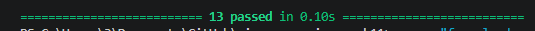

# 성적 CSV 읽기 및 테스트

## ① 무엇을 하나요 (What)

`load_scores.py`는 성적 CSV 파일을 읽어 유효한 `(이름, 점수)` 목록과 건너뛴 행의 기록을 반환합니다.

## ② 왜 만들었나요 (Why)

성적 파일에는 열 개수가 맞지 않는 행, 빈 이름이나 점수, 정수가 아닌 점수, 0~100 범위를 벗어난 점수가 섞일 수 있습니다. 이런 행을 구분해 처리하고, 건너뛴 이유를 남겨 데이터 확인이 가능하도록 만들었습니다. 이름이 같다는 이유만으로 동명이인의 기록을 삭제하지 않습니다.

## ③ 어떻게 쓰나요 (How)

Python과 pytest가 설치된 환경에서 week11 폴더로 이동해 실행합니다.

```bash
py -c "from load_scores import load_scores; print(load_scores('scores.csv'))"
```

테스트 도구 설치:

```bash
pip install pytest pytest-cov
```

## ④ 어떻게 테스트하나요

직접 작성한 테스트:

```bash
py -m pytest -v test_load_scores.py
```

AI에게 코드를 제공한 테스트와 명세를 제공한 테스트:

```bash
pytest test_ai_A.py -q
pytest test_ai_B.py -q
```

세 테스트 묶음의 결과를 각각 실행해 비교합니다.

```bash
pytest --cov=load_scores --cov-report=term-missing
```

## ⑤ 파일 구성

| 파일 | 하는 일 |
| --- | --- |
| `load_scores.py` | 배포된 성적 CSV 읽기 함수 |
| `scores.csv` | 배포된 성적 데이터 파일 |
| `empty.csv` | 빈 CSV 실습 파일 |
| `weird.csv` | 예외 데이터 실습 파일 |
| `bug3_logic.py` | 논리 오류 실습 코드 |
| `prompts.txt` | A/B/함정 프롬프트 원문 |
| `.gitignore` | Git 제외 파일 설정 |
| `README_양식.md` | README 작성 양식 |
| `test_load_scores.py` | 직접 작성한 테스트 |
| `test_ai_A.py` | 코드 제공 방식으로 작성한 AI 테스트 |
| `test_ai_B.py` | 명세 제공 방식으로 작성한 AI 테스트 |
| `README.md` | 프로젝트 설명 및 실행 안내 |

## ⑥ 만든 사람 · AI를 어디에 썼는지

- 만든 사람: 기계공학부 임재욱
- AI를 쓴 곳: `test_ai_A.py`와 `test_ai_B.py`의 테스트 초안 작성
- 내가 직접 판단한 것: 배포 코드의 명세와 경계값을 확인하고, 직접 작성한 테스트와 AI 테스트의 결과를 비교

## 라이선스

라이선스는 [LICENSE](./LICENSE) 파일을 참고하세요.